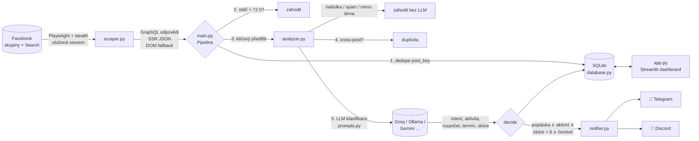

# 🎯 FB Lead Hunter

Bezplatná alternativa k Apify: hlídá Facebook skupiny a FB vyhledávání, najde **aktivní poptávky po tvorbě nebo úpravě webu**,
vyřadí nabídky služeb, spam a staré příspěvky a do pár sekund ti pošle upozornění na Telegram nebo Discord.
Leady pak spravuješ ve Streamlit dashboardu.

- **Scraping:** Python + Playwright + `playwright-stealth`, přihlášení přes uloženou session (cookies), lidské chování, rate limiting
- **Filtrace:** klíčový předfiltr (zdarma, offline) → LLM klasifikace záměru (Groq / Ollama / Gemini / OpenAI-kompatibilní API)
- **Data:** SQLite s deduplikací podle ID příspěvku i podle obsahu (stejná poptávka vložená do 5 skupin = 1 lead)
- **Notifikace:** Telegram bot a/nebo Discord webhook
- **UI:** Streamlit: leady, stavy (Nekontaktováno / Kontaktováno / Odpověděli / Zamítnuto), skupiny, klíčová slova, audit a testy
- **Kontakty:** u každého leadu odkaz na FB profil autora, tlačítko „Napsat zprávu“ (Messenger) a telefon, e-mail a web, pokud je autor uvedl v příspěvku. Export do CSV.

Hlásí jen poptávky po **novém webu, e-shopu, landing page nebo redesignu** (`LEAD_PROJECT_TYPES` v `.env`).
Drobné úpravy, správu webu a SEO vynechává. Když je chceš taky, přidej `uprava,sprava,seo_rychlost`.

## ⚡ Rychlý start

**Co potřebuješ (vše zdarma):**

| | Kde to získáš | Kam to dáš |
|---|---|---|
| Počítač s Windows / macOS / Linux, který může běžet celý den | ideálně doma (domácí IP je pro FB nejbezpečnější) | – |
| Python 3.10+ | [python.org/downloads](https://www.python.org/downloads/), na Windows zaškrtni „Add python.exe to PATH“ | – |
| FB účet, který je členem skupin, kde se poptávky objevují | tvůj vedlejší účet s historií | `login.bat` / `scraper.py login` |
| API klíč Groq (LLM) | [console.groq.com/keys](https://console.groq.com/keys), přihlášení Googlem, „Create API Key“ | `LLM_API_KEY` v `.env` |
| Telegram bot | @BotFather → `/newbot` (návod v kapitole 5) | `TELEGRAM_BOT_TOKEN`, `TELEGRAM_CHAT_ID` v `.env` |
| Seznam FB skupin | URL skupin, kde se objevují poptávky | dashboard → Skupiny & hledání |

**Windows:** dvojklik na `install.bat` → vyplň `.env` (Poznámkový blok) → `login.bat` → `start.bat`.

**macOS / Linux:**
```bash
./install.sh                       # vytvoří .venv, nainstaluje závislosti a prohlížeč, založí .env
nano .env                          # vyplň LLM_API_KEY, TELEGRAM_BOT_TOKEN, TELEGRAM_CHAT_ID
.venv/bin/python scraper.py login  # přihlášení na Facebook v okně prohlížeče
./start.sh                         # spustí worker + dashboard (http://localhost:8501)
```

Aplikace startuje s prázdnou databází (všechny statistiky na nule). Kdykoli ji vynuluješ v dashboardu:
**⚙️ Systém → Začít od nuly**.

---

## 1. Architektura



Stejný tok v textu:

```
FB skupina / FB Search
   │  Playwright (stealth, cookies, lidské skrolování, limity)
   ▼
scraper.py ── GraphQL (/api/graphql) ─┐
           ── SSR <script> JSON ──────┼─► ScrapedPost {post_id, text, autor, url, creation_time}
           ── DOM fallback ───────────┘
   ▼
main.py / Pipeline
   1. INSERT OR IGNORE podle post_key            → už známe? konec
   2. starší než MAX_POST_AGE_HOURS?             → skipped: too_old
   3. KeywordPrefilter (téma ∧ poptávka ∧ ¬nabídka ∧ ¬spam) → skipped: prefilter:*
   4. stejný obsah už analyzován (cross-post)?   → skipped: duplicate
   5. LLMClassifier → JSON {intent, is_active, relevance_score, budget, deadline, …}
   6. decide(): intent=poptavajici ∧ is_active ∧ score > 8 ∧ čerstvé → LEAD
   ▼
SQLite (posts, sources, keywords, runs, page_loads, kv)
   ├─► notifier.py → Telegram / Discord (hned po nalezení)
   └─► app.py (Streamlit) → správa leadů, skupin, klíčových slov
```

### Struktura projektu

| Soubor | Účel |
|---|---|
| `scraper.py` | Playwright scraper: stealth, session, lidské chování, odchyt GraphQL, DOM fallback, CLI (`login`, `import-cookies`, `check`, `test`) |
| `analyzer.py` | Předfiltr klíčových slov, LLM klient (Ollama + OpenAI-kompatibilní API), validace výstupu, finální rozhodnutí |
| `prompts.py` | **System prompt klasifikátoru** (poptávka vs. nabídka vs. diskuse) + šablona dotazu |
| `database.py` | SQLite: schéma, deduplikace, stavy leadů, zdroje, klíčová slova, log načtení stránek |
| `notifier.py` | Telegram (zpráva s kontakty + tlačítka „Příspěvek“ a „Napsat zprávu“) a Discord (embed) s retry |
| `main.py` | Worker: plánování cyklů, aktivní hodiny, pauzy, cooldown po blokaci, heartbeat |
| `app.py` | Streamlit dashboard |
| `config.py` | Konfigurace z `.env` + výchozí klíčová slova |
| `evaluate.py` | Měření přesnosti předfiltru a LLM na označených vzorcích |
| `tests/` | 62 testů včetně end-to-end běhu Playwrightu proti napodobenině FB |

### Proč čtení GraphQL a ne jen HTML?

FB má HTML záměrně zamlžené: třídy se mění, čas příspěvku je v DOM rozsekaný na náhodně seřazené znaky.
Když ale skroluješ, FB si příspěvky dotahuje přes `/api/graphql/` a v odpovědích je čistý JSON:
`post_id`, celý text (bez „Zobrazit víc“), autor, URL a hlavně **`creation_time` (UNIX čas)**. Díky tomu
spolehlivě zahodíme staré příspěvky. Parser nehledá pevnou cestu v JSONu. Hledá uzly `Story` a v nich
nejmělčí výskyt `message.text` / `creation_time`, takže přežije i menší změny struktury. Když přesto
selže, nastoupí DOM fallback.

---

## 2. Instalace (lokálně)

Potřebuješ **Python 3.10+** (Windows, macOS i Linux).

```bash
git clone <tento-repozitář> fb-lead-hunter
cd fb-lead-hunter

python -m venv .venv
# Windows:   .venv\Scripts\activate
# Linux/Mac: source .venv/bin/activate

pip install -r requirements.txt
playwright install chromium          # stáhne prohlížeč (~150 MB)

cp .env.example .env                 # Windows: copy .env.example .env
```

Otevři `.env` a vyplň aspoň LLM a notifikace (viz níže).

---

## 3. Přihlášení na Facebook (session / cookies)

> 💡 **Doporučení:** použij účet, na kterém ti nezáleží až tolik, jako na osobním (např. starší vedlejší účet
> s historií, který je členem cílových skupin). Úplně nový účet je pro FB podezřelejší než starý.

### Varianta A: přihlášení v okně (doporučeno, nejspolehlivější)

```bash
python scraper.py login
```

Otevře se okno prohlížeče se stejným otiskem, jaký pak používá scraper. Přihlas se (včetně 2FA), počkej na
feed, vrať se do terminálu a stiskni **ENTER**. Session se uloží do `data/fb_state.json`.

### Varianta B: export cookies z běžného prohlížeče

1. V Chrome/Edge/Firefoxu nainstaluj rozšíření **Cookie-Editor** (cookie-editor.com) nebo **EditThisCookie**.
2. Otevři `https://www.facebook.com` a ujisti se, že jsi přihlášený.
3. Klikni na ikonu rozšíření → **Export** → **Export as JSON** (zkopíruje se do schránky).
4. Ulož obsah do souboru, např. `cookies.json` (je v `.gitignore`).
5. Importuj:
   ```bash
   python scraper.py import-cookies cookies.json
   ```
   Skript ověří, že export obsahuje klíčové cookies `c_user` a `xs`, a převede ho do formátu Playwrightu.
6. **Smaž `cookies.json`.** Je to plnohodnotný přístup k tvému účtu.

> ⚠️ Po exportu se ve svém prohlížeči **neodhlašuj**. Odhlášení zneplatní i exportovanou session.
> Do `.env` dej `USER_AGENT` stejného prohlížeče, ze kterého cookies pocházejí (najdeš ho na `chrome://version`).

### Ověření

```bash
python scraper.py check
python scraper.py test https://www.facebook.com/groups/<id-skupiny>/     # vypíše nalezené příspěvky
python scraper.py test "hledám webaře" --search
```

Scraper po každém běhu ukládá **obnovené cookies** zpět (FB je průběžně rotuje), takže session vydrží týdny.
Když vyprší, worker se sám pozastaví a pošle upozornění. Pak stačí znovu `python scraper.py login`.

---

## 4. LLM klasifikátor (zdarma)

| Poskytovatel | Cena | Přesnost v češtině | Nastavení v `.env` |
|---|---|---|---|
| **Groq** (doporučeno) | free tier | výborná (Llama 3.3 70B) | `LLM_PROVIDER=groq`, `LLM_API_KEY=gsk_…` z [console.groq.com](https://console.groq.com/keys) |
| **Google Gemini** | free tier | výborná | `LLM_PROVIDER=gemini`, klíč z [aistudio.google.com](https://aistudio.google.com/apikey) |
| **Ollama** (lokálně) | zdarma, offline | dobrá u modelů 8–14B | `LLM_PROVIDER=ollama`, `LLM_MODEL=…` |
| OpenRouter / OpenAI | free modely / placené | dle modelu | `LLM_PROVIDER=openrouter` nebo `openai` |

Výchozí modely najdeš v `config.py` (`LLM_PRESETS`). Přepíšeš je přes `LLM_MODEL`. Názvy modelů se u poskytovatelů
časem mění. Když dostaneš chybu „model not found“, podívej se do jejich aktuálního seznamu.

**Ollama:**
```bash
# instalace: https://ollama.com/download
ollama pull qwen2.5:14b      # nejlepší čeština z menších modelů (~9 GB RAM)
# alternativy: gemma2:9b, llama3.1:8b (nejrychlejší, ale v češtině slabší), mistral-nemo
```
```env
LLM_PROVIDER=ollama
LLM_MODEL=qwen2.5:14b
```

Spotřeba: díky předfiltru jde do LLM jen zlomek příspěvků (typicky 2–10 %), takže free tier běžně stačí.
`LLM_MAX_REQUESTS_PER_MINUTE` hlídá limit poskytovatele. Při chybě 429 klient počká a zkusí to znovu.
Když LLM nedostupné, příspěvek se uloží a analyzuje v dalším cyklu.

### System prompt

Celý prompt je v [`prompts.py`](prompts.py). Je postavený takhle:

1. **Definice záměru:** `poptavajici` / `nabizejici` / `diskuse` / `spam` / `jine`, s konkrétními signály.
2. **Pasti:** výslovně řeší případy, na kterých keyword filtry selhávají: „nabízím 15 000 Kč“ (= poptávka),
   „hledám klienty / práci“ (= nabídka), reklama maskovaná otázkou, subdodávky agentur, HPP inzeráty, DIY dotazy,
   poptávky jen loga nebo sociálních sítí.
3. **Aktivita:** „EDIT: vyřešeno“, „už mám“, stáří > 14 dní → `is_active=false`.
4. **Extrakce:** rozpočet, termín, urgence, typ projektu, platforma, lokalita. Jen to, co v textu opravdu je.
5. **Rubrika skóre 1–10** s pravidlem „9–10 jen pro jednoznačnou aktivní poptávku, buď konzervativní“.
6. **Přesné JSON schéma** výstupu (+ JSON mode u API / `format: json` u Ollamy).
7. **Šest few-shot příkladů** včetně nejzrádnějších případů.

Finální rozhodnutí ale **nedělá LLM**. Dělá ho deterministický kód (`analyzer.decide`):
`intent == poptavajici` ∧ `is_active` ∧ `skóre > MIN_RELEVANCE_SCORE (8)` ∧ `stáří ≤ MAX_POST_AGE_HOURS`.

---

## 5. Notifikace

### Telegram (doporučeno: push do telefonu za pár sekund)

1. V Telegramu napiš **@BotFather** → `/newbot` → zadej jméno → dostaneš **token** (`123456:ABC…`).
2. Napiš svému novému botovi libovolnou zprávu (např. „ahoj“).
3. V prohlížeči otevři `https://api.telegram.org/bot<TOKEN>/getUpdates` a najdi `"chat":{"id": 123456789…}`.
   (Pro skupinu: přidej bota do skupiny, napiš tam zprávu, ID skupiny začíná `-100…`.)
4. Do `.env`:
   ```env
   TELEGRAM_BOT_TOKEN=123456:ABC...
   TELEGRAM_CHAT_ID=123456789
   ```

### Discord

Server → *Nastavení serveru → Integrace → Webhooky → Nový webhook* → zkopíruj URL do `DISCORD_WEBHOOK_URL`.

Obojí otestuješ v dashboardu na kartě **⚙️ Systém → Poslat testovací lead**.

---

## 6. Spuštění

Potřebuješ dva terminály (oba s aktivovaným `.venv`):

```bash
# Terminál 1: dashboard (http://localhost:8501)
streamlit run app.py

# Terminál 2: worker (běží trvale)
python main.py
```

1. V dashboardu na kartě **👥 Skupiny & hledání** přidej URL skupin (účet musí být jejich členem).
2. Uprav FB Search dotazy (výchozí: „poptávám tvorbu webu“, „hledám webaře“…).
3. Worker běží v cyklech po 20–40 min (náhodně), jen v aktivních hodinách (7–23 h).
   Tlačítko **⚡ Spustit teď** v dashboardu cyklus spustí hned.

Další přepínače workeru: `python main.py --once` (jeden cyklus, třeba pro cron), `--force` (ignoruje heartbeat jiného workeru).

### Běh 24/7

**Linux (systemd):** `/etc/systemd/system/fb-lead-hunter.service`
```ini
[Unit]
Description=FB Lead Hunter worker
After=network-online.target

[Service]
WorkingDirectory=/home/ja/fb-lead-hunter
ExecStart=/home/ja/fb-lead-hunter/.venv/bin/python main.py
Restart=on-failure
RestartSec=60
User=ja

[Install]
WantedBy=multi-user.target
```
```bash
sudo systemctl enable --now fb-lead-hunter
journalctl -u fb-lead-hunter -f
```
Pro dashboard udělej obdobnou službu s `ExecStart=… -m streamlit run app.py --server.headless true`.

**Windows:** Plánovač úloh → *Vytvořit úlohu* → Aktivační událost „Při přihlášení“ → Akce:
program `C:\cesta\fb-lead-hunter\.venv\Scripts\python.exe`, argumenty `main.py`, „Začít v“ = složka projektu.

> Nejlepší je provozovat to na počítači / domácím serveru (Raspberry Pi 5, starý notebook) se stejnou
> domácí IP, ze které se k účtu běžně přihlašuješ. Datacentrové IP (VPS) jsou pro FB podezřelé. Pokud
> musíš běžet na VPS, použij rezidenční proxy z ČR (`PROXY=`).

---

### Kontakty na autory

| Údaj | Odkud | Kde ho uvidíš |
|---|---|---|
| Jméno + odkaz na FB profil | data příspěvku (autor) | dashboard, notifikace, CSV |
| „Napsat zprávu“ | `facebook.com/messages/t/<ID autora>`, otevře Messenger s autorem | dashboard, tlačítko v Telegramu |
| Telefon, e-mail, web | jen pokud je autor sám napsal do příspěvku (rozpoznávají se CZ/SK čísla) | dashboard, notifikace, CSV |

Export: **🎯 Leady → ⬇️ Stáhnout kontakty (CSV)**. Soubor se otevře v Excelu se správnou diakritikou.

Facebook neumožňuje zjistit e-mail ani telefon, který autor nezveřejnil. Pokud v příspěvku chybí, napiš mu
přes Messenger nebo do komentáře pod poptávkou. Zprávy od lidí, které nemá v přátelích, mu padají do
„Žádostí o zprávu“, takže komentář „Dobrý den, poslal jsem vám nabídku do zpráv“ zvyšuje šanci na odpověď.

---

## 7. Ochrana účtu: strategie dlouhodobého běhu

| Opatření | Jak je implementováno |
|---|---|
| **Konzistentní otisk** | Stejný User-Agent, viewport, `cs-CZ`, `Europe/Prague` při každém běhu i při loginu. Náhodné střídání UA je naopak podezřelé. |
| **Stealth** | `playwright-stealth` (skrývá `navigator.webdriver`, doplní pluginy, WebGL, `chrome.runtime`…) + `--disable-blink-features=AutomationControlled`. Volitelně skutečný Chrome (`BROWSER_CHANNEL=chrome`). |
| **Lidské chování** | Skrolování kolečkem po nerovnoměrných krocích, pohyby myši, občasné vrácení nahoru, pauzy 2–5 s, občas 6–14 s „čtení“, rozehřátí na hlavním feedu na začátku cyklu. |
| **Rozložení v čase** | Cykly po 20–40 min s náhodným rozptylem, pauza 40–120 s mezi skupinami, náhodné pořadí zdrojů, jen v aktivních hodinách. |
| **Tvrdé limity** | Max. 25 načtení stránek za hodinu a 250 za den. Limity se počítají v DB, takže platí i po restartu. |
| **Šetrné skrolování** | Skrolování skončí dřív, když narazí na 6 už známých nebo 5 starých příspěvků. Většina návštěv má jen pár skrolů. |
| **Jen čtení** | Scraper nikdy nelajkuje, nekomentuje, nepíše zprávy ani nepřidává přátele. Kontaktuješ ručně. |
| **Okamžité zastavení** | Při checkpointu nebo vypršelé session se worker pozastaví. Při hlášce „dočasně zablokováno“ dá 24h cooldown. V obou případech pošle upozornění. |
| **Jediná instance** | Heartbeat v DB zabrání spuštění dvou workerů zároveň. |
| **Bez videí** | `BLOCK_MEDIA=true` blokuje stahování videí (méně dat). Obrázky se načítají normálně. |

**Doporučení:** začni s 5–10 skupinami a výchozími limity. Prvních 14 dní nech běžet konzervativně
(klidně `CYCLE_INTERVAL_MIN_MINUTES=40`). Když dostaneš checkpoint, vyřeš ho ručně v normálním prohlížeči,
pár dní počkej, pak spusť `python scraper.py login` a limity sniž.

---

## 8. Ladění přesnosti

- **🔍 Audit příspěvků** v dashboardu ukazuje všechny stažené příspěvky a proč byly zamítnuté
  (`prefilter:no_topic`, `intent:nabizejici`, `low_score:7`, `too_old`…). Přehlédnutý lead označíš ručně.
- **🔑 Klíčová slova:** téma / poptávka / negativní fráze. Je tam živý tester předfiltru.
- **⚙️ Systém → Test LLM:** vlož libovolný text a uvidíš přesný JSON od modelu.
- **`python evaluate.py`** změří precision/recall na `tests/fixtures/labeled_posts.jsonl`. Přidávej tam reálné
  příspěvky, na kterých se systém spletl, a laď prompt nebo model, dokud nejsou výsledky stabilní.

Předfiltr je nastavený na **maximální záchyt** (na vzorcích zachytí 100 % leadů). Zjevné nabídky a spam
zahodí sám, nejasné případy (diskuse, HPP inzeráty) posílá dál a o přesnosti rozhoduje LLM.
Pokud chceš ještě přísnější výběr, zvyš `MIN_RELEVANCE_SCORE=9` (jen skóre 10).

---

## 9. Testy

```bash
pip install -r requirements-dev.txt
pytest -q
```

Testy pokrývají předfiltr, parsování LLM výstupu, rozhodovací pravidla, DB a deduplikaci, pipeline (lead →
notifikace, cross-post, retry po chybě LLM), parsování FB GraphQL/času/URL, import cookies, formát notifikací
a **end-to-end běh Playwrightu** proti lokální napodobenině FB (stealth, odchyt GraphQL, SSR, DOM fallback).

---

## 10. Řešení problémů

| Problém | Řešení |
|---|---|
| `Chybí uložená session` | `python scraper.py login` nebo `import-cookies` |
| Worker „⏸️ Pozastaven“ | Důvod je v dashboardu. Po vyřešení klikni **▶️ Obnovit** (po `login` se obnoví sám). |
| `Executable doesn't exist … playwright install` | `playwright install chromium`, případně `BROWSER_EXECUTABLE_PATH=` na existující Chromium/Chrome |
| 0 příspěvků ze skupiny | `HEADLESS=false` a `python scraper.py test <url>` ukáže, co prohlížeč vidí (jsi členem? nezměnil FB jazyk?) |
| Ve výpisu jen `[dom]` příspěvky | FB změnil strukturu GraphQL. DOM fallback pořád funguje, jen bez přesného času. Pošli issue. |
| LLM `HTTP 401` / `model not found` | Zkontroluj `LLM_API_KEY` a `LLM_MODEL` v `.env` |
| Notifikace nechodí | Dashboard → Systém → Poslat testovací lead. U Telegramu musíš botovi nejdřív sám napsat. |

---

## ⚖️ Právní upozornění

- Automatizovaný sběr dat **porušuje Podmínky použití Facebooku**. Hrozí omezení nebo zrušení účtu. Používáš na vlastní riziko.
- Příspěvky obsahují **osobní údaje** (jména, texty). Podle GDPR potřebuješ právní titul (oprávněný zájem
  u B2B poptávek), data drž jen po nezbytnou dobu, nesdílej je a na žádost je smaž. Databáze je jen lokálně u tebe.
- Při oslovení se představ a vztahuj se ke konkrétní poptávce. Hromadné nevyžádané zprávy jsou spam.
